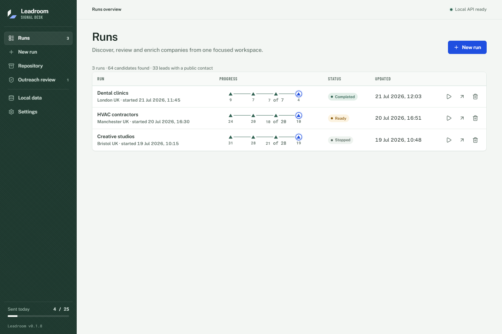
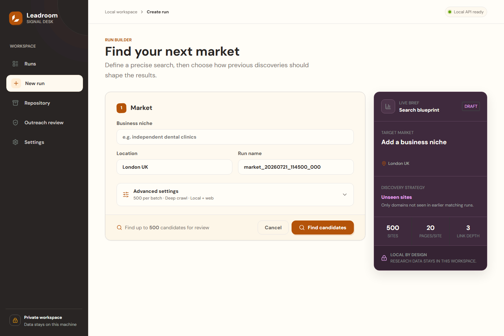
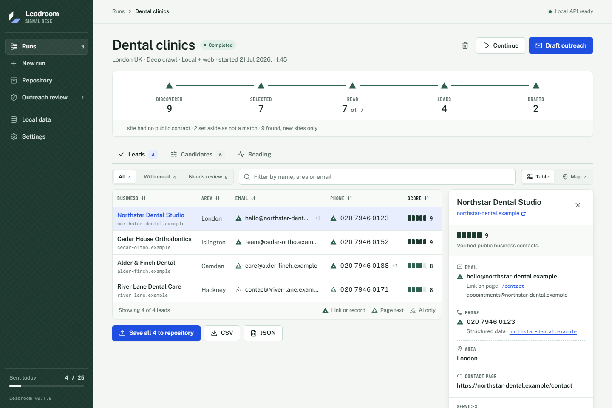
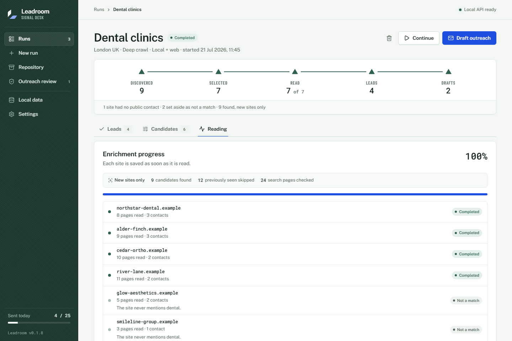
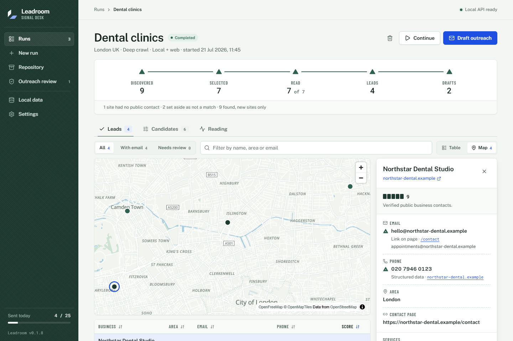
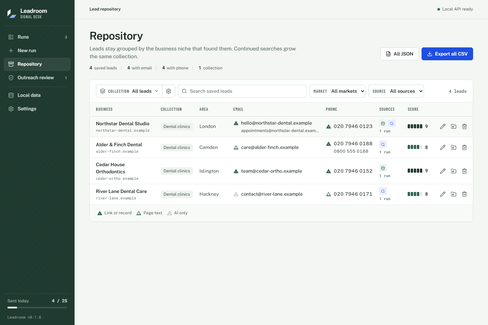
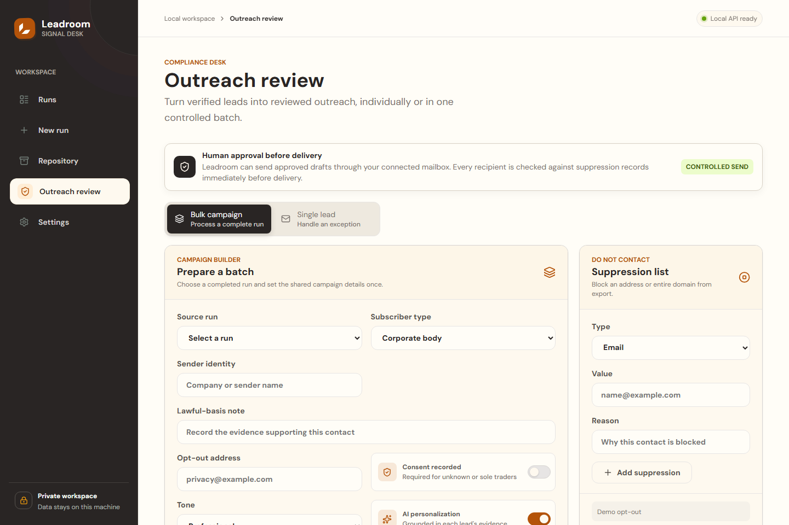
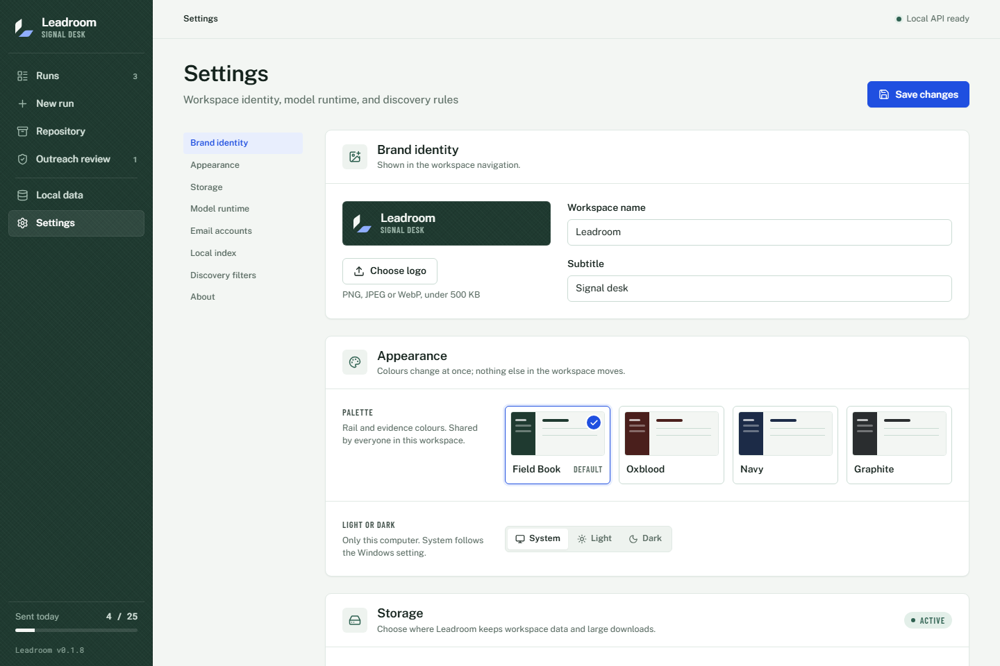

<p align="center">
  
</p>

<h1 align="center">Leadroom</h1>

<p align="center" dir="rtl">
  <b>کسب‌وکارهای محلی را پیدا کنید، اطلاعات تماس عمومی‌شان را جمع کنید و با دقت با آن‌ها تماس بگیرید.<br>
  همه در یک فضای کاری خصوصی روی کامپیوتر ویندوزی خودتان.</b>
</p>

<p align="center">
  <a href="https://github.com/thesaikodelik/Leadroom/releases/latest/download/Leadroom-Setup.exe"></a>
</p>

<p align="center">
  
  
  
  
  
  
</p>

<p align="center">
  <a href="README.md">English</a> · <b>فارسی</b>
</p>

<p align="center">
  
</p>

<div dir="rtl">

برنامهٔ **Leadroom** یک حوزهٔ کاری و یک شهر را می‌گیرد، مثلاً «کلینیک‌های دندان‌پزشکی مستقل در لندن»، و فهرستی بررسی‌شده از کسب‌وکارهای واقعی با ایمیل و شماره‌تلفن عمومی‌شان تحویل می‌دهد. در وب جست‌وجو می‌کند، سایت خود هر کسب‌وکار را می‌خواند، جاهای خالی را با یک مدل هوش مصنوعی محلی پر می‌کند و همهٔ لیدها را در یک مخزن بدون تکرار نگه می‌دارد. از آنجا می‌توانید خروجی بگیرید یا یک کمپین ایمیل کنترل‌شده راه بیندازید.

همه‌چیز روی کامپیوتر خودتان اجرا می‌شود. فضای کاری، لیدها و کلیدهایتان همان‌جا می‌مانند و مدل پیش‌فرض هوش مصنوعی هم با [Ollama](https://ollama.com/) روی همین سیستم کار می‌کند. البته جست‌وجو و خواندن سایت‌ها به اینترنت نیاز دارد.

</div>

<p align="center" dir="rtl">
  <a href="#how-it-works">روش کار</a> ·
  <a href="#repository">مخزن لیدها</a> ·
  <a href="#outreach">ارسال ایمیل</a> ·
  <a href="#settings">تنظیمات</a> ·
  <a href="#install">نصب</a> ·
  <a href="#privacy">حریم خصوصی</a> ·
  <a href="#developers">برای برنامه‌نویس‌ها</a>
</p>

---

<div dir="rtl">

<a id="how-it-works"></a>

## 🧭 روش کار

### ۱. بازار هدف را مشخص کنید



یک **حوزهٔ کاری** و یک **شهر** بنویسید و مشخص کنید جست‌وجو چقدر گسترده باشد.

- **منبع:** وب، نقشهٔ محلی خصوصی یا هر دو با هم.
- **جست‌وجوی گسترده:** Leadroom بازار را با کلمه‌های دیگری هم می‌گردد که یک کسب‌وکار ممکن است به کار ببرد (مثلاً *Persian* به‌جای *Iranian*)، محله‌به‌محله در کل شهر جست‌وجو می‌کند و دایرکتوری‌ها و فهرست‌های «بهترین‌ها» را برای کسب‌وکارهایی که نام برده‌اند می‌خواند.
- **فقط سایت‌های تازه:** جست‌وجوی دوباره در همان بازار، دامنه‌هایی را که قبلاً پیدا شده‌اند کنار می‌گذارد.
- **عمق خواندن:** سریع (تا ۶ صفحه از هر سایت)، عمیق (تا ۲۰ صفحه) یا کامل (تا ۴۰ صفحه). Leadroom به محض پیدا کردن اطلاعات تماس یک سایت، خواندن آن را تمام می‌کند.
- یک **خلاصهٔ زنده** کنار فرم نشان می‌دهد جست‌وجو قبل از شروع دقیقاً چه کاری می‌کند.

<br clear="left">

### ۲. کسب‌وکارهایی را که واقعاً می‌خواهید نگه دارید



در این مرحله Leadroom همهٔ **کاندیداهایی** را که پیدا کرده با منبعشان نشان می‌دهد. سایت‌های فهرستی، جمع‌کننده‌ها و هر چیزی را که بیرون از بازار هدفتان است حذف کنید و برای بقیه استخراج اطلاعات را شروع کنید.

- **پیشرفت**، خطاها و شواهد هر سایت را همان لحظه ببینید.
- هر وقت خواستید **متوقف** کنید و بعد **ادامه** دهید؛ نتیجه بعد از هر سایت ذخیره می‌شود.
- اگر لید بیشتری لازم دارید، همان جست‌وجو را **ادامه** دهید: هر بار محله‌های بعدی و کسب‌وکارهایی که فهرست‌های قبلی نام برده بودند جست‌وجو می‌شوند.

<br clear="left">

### ۳. خواندن سایت‌ها را به Leadroom بسپارید



برای هر کسب‌وکار، Leadroom فقط داخل دامنهٔ خودش می‌ماند و اول صفحه‌های مهم‌تر را می‌خواند: تماس با ما، درباره، خدمات، شعبه‌ها و نقشهٔ سایت.

بعد بررسی می‌کند که آن کسب‌وکار واقعاً جزو بازار شما باشد. سایتی که هیچ‌جا از چیزی که بازار را مشخص می‌کند حرف نزده (مثلاً *Iranian* در *Iranian supermarket*)، با برچسب **Not a match** و دلیلش کنار گذاشته می‌شود و وارد لیدها نمی‌شود. سایتی که بازار را با کلمه‌های دیگری توصیف کرده نگه داشته می‌شود و برای یک نگاه سریع علامت می‌خورد.

<br clear="left">

| مرحله | چه اتفاقی می‌افتد |
| --- | --- |
| 🔎 **استخراج** | ایمیل، تلفن و مشخصات کسب‌وکار مستقیم از متن صفحه و داده‌های ساختاریافته‌اش خوانده می‌شود. |
| 🧠 **تکمیل** | یک مدل هوش مصنوعی محلی، از طریق [ScrapeGraphAI](https://github.com/ScrapeGraphAI/Scrapegraph-ai)، چیزهایی را که صفحه صریح نگفته پیدا می‌کند. |
| 🛡 **تلاش دوباره، با احترام** | صفحه‌ای که درخواست ساده را رد کند، یک بار با Scrapling و بعد با یک مرورگر واقعی دوباره امتحان می‌شود. صفحه‌های ورود، محتوای پولی و CAPTCHA هیچ‌وقت دور زده نمی‌شوند. |
| ✅ **مرتب‌سازی** | برای هر کسب‌وکار حداکثر سه ایمیل و سه شماره، یکدست و بدون تکرار. |

### ۴. شواهد را بررسی کنید و ببینید کجا هستند



کنار هر ایمیل و تلفن یک مثلث کوچک هست که می‌گوید آن جزئیات چطور پیدا شده:

- **توپر**: خود کسب‌وکار آن را به‌صورت لینک، در دادهٔ ساختاریافته یا در رکورد نقشه‌اش منتشر کرده.
- **یک‌سوم پایین پر**: در متن صفحه‌های خود کسب‌وکار آمده.
- **خط‌چین**: مدل هوش مصنوعی آن را خوانده و روی صفحه پیدا نشده؛ پس اول همین را بررسی کنید.

با انتخاب هر لید، صفحهٔ منبعِ هر جزئیات را می‌بینید. با **Map** لیدهای یک جست‌وجو را روی نقشه ببینید؛ لیدهایی که موقعیت نقشه ندارند در فهرست می‌مانند.

<br clear="left">

<a id="repository"></a>

## 🗂 یک مخزن برای همهٔ لیدها

</div>

<p align="center">
  
</p>

<div dir="rtl">

لیدهای خوب هر جست‌وجو را در **مخزن** ذخیره کنید. کسب‌وکارها با دامنه‌شان شناخته می‌شوند، پس جست‌وجوی دوباره در همان بازار مجموعه را **کامل‌تر** می‌کند و لید تکراری نمی‌سازد.

- **مجموعه‌ها** بر اساس حوزهٔ کاری‌ای که پیدایشان کرده، با جست‌وجو و فیلتر.
- **شاهد** برای هر مقدار: از کدام جست‌وجو و کدام صفحه آمده.
- ویرایش، جابه‌جایی یا حذف هر لید از همان ردیف.
- **خروجی** CSV یا JSON از همه‌چیز یا از یک مجموعه.

<a id="outreach"></a>

## ✉️ ارسال ایمیل، با تأیید شما



یک جست‌وجوی تمام‌شده را به کمپین ایمیل تبدیل کنید. هوش مصنوعی متن هر ایمیل را از روی شواهد همان کسب‌وکار می‌نویسد، ولی **هیچ ایمیلی بدون تأیید شما فرستاده نمی‌شود**. ارسال از طریق صندوق ایمیل خودتان انجام می‌شود.

- فقط ایمیل‌های عمومی کسب‌وکار، با حداقل امتیاز مشخص.
- فیلدهای مبنای قانونی و رضایت، و یک **فهرست «تماس نگیرید»** که درست قبل از ارسال هم دوباره چک می‌شود.
- **حداکثر ۲۵ ایمیل در هر ۲۴ ساعت**، فقط یک کمپین در لحظه، و دکمهٔ توقف.
- با هر صندوق ایمیلی که SMTP داشته باشد کار می‌کند (STARTTLS یا SSL/TLS).

> این کنترل‌ها خطا را کم می‌کنند، ولی مشاورهٔ حقوقی نیستند. قبل از تماس با هر کسی [COMPLIANCE.md](COMPLIANCE.md) را بخوانید. مسئولیت گرفتن رضایت و رعایت قانون محل کارتان با خود شماست.

<br clear="left">

<a id="settings"></a>

## 🎨 مال خودتان کنید



- **هویت شما:** نام فضای کاری، زیرعنوان و لوگو در نوار کناری.
- **ده پوسته**، همه سبک و کم‌مصرف.
- **مدل هوش مصنوعی:** مدل‌های Ollama را ببینید، دانلود کنید، عوض کنید و بسنجید، یا به‌جایش یک سرویس سازگار با OpenAI وصل کنید.
- **محل ذخیره:** فضای کاری و دانلودهای حجیم (مدل‌ها، فایل‌های مرورگر و داده‌های نقشه) را روی هر درایوی که خواستید بگذارید.
- **قواعد جست‌وجو:** فهرست سایت‌هایی که باید نادیده گرفته شوند، به انتخاب خودتان.

<br clear="left">

<a id="install"></a>

## 📦 نصب

۱. فایل **[Leadroom-Setup.exe](https://github.com/thesaikodelik/Leadroom/releases/latest/download/Leadroom-Setup.exe)** را از [آخرین نسخهٔ منتشرشده](https://github.com/thesaikodelik/Leadroom/releases/latest) دانلود کنید.

۲. اجرایش کنید و مرحله‌ها را جلو بروید. روی کامپیوتر تازه، گزینه‌های پیشنهادی را تیک‌خورده نگه دارید.

۳. وقتی نصب تمام شد، **Leadroom** را از منوی Start باز کنید.

فایل نصب برای **کامپیوتری کاملاً تازه** ساخته شده. فقط برای حساب کاربری شما نصب می‌شود، **دسترسی ادمین نمی‌خواهد** و پیشنهاد می‌دهد هر چیزی را که Leadroom لازم دارد خودش آماده کند:

| بخش | کاری که فایل نصب می‌کند |
| --- | --- |
| **Microsoft Edge WebView2** | اگر نباشد نصبش می‌کند (پنجرهٔ برنامه به آن نیاز دارد). |
| **Ollama** | اگر نباشد نصبش می‌کند؛ با Windows Package Manager، و اگر آن هم نبود، مستقیم از ollama.com. |
| **مدل `llama3.2:3b`** | آن را (حدود ۲ گیگابایت) در پوشه‌ای که انتخاب کرده‌اید دانلود می‌کند و پیشرفتش را نشان می‌دهد. |
| **نقشهٔ محلی کامل** | اختیاری و برای سیستم‌های قوی: WSL2، PostgreSQL و داده‌های OpenStreetMap. |

اگر اینستالر نمی‌خواهید، در همان صفحه فایل **Leadroom-Portable.zip** هم هست؛ برای آن باید WebView2 و Ollama از قبل نصب باشند. هر مرحلهٔ نصب را می‌شود لغو کرد و چیزهایی که از قبل نصب‌اند دوباره نصب نمی‌شوند. فایل نصب روی ویندوزهای تازه، هم با Windows Package Manager و هم بدون آن، آزموده شده است.

> ویندوز برای برنامه‌های تازه و بدون امضا ممکن است پیغام *«Windows protected your PC»* نشان بدهد. روی **More info** و بعد **Run anyway** بزنید. کد Leadroom باز است؛ می‌توانید خطبه‌خطش را بخوانید یا خودتان بسازیدش.

**به‌روزرسانی خودش می‌آید.** وقتی Leadroom باز است، نسخهٔ جدید را چک می‌کند و در نوار کناری خبر می‌دهد. با یک کلیک دانلود می‌شود و با **Restart now** نصب می‌شود و نسخهٔ جدید باز می‌شود. امضای هر به‌روزرسانی پیش از اجرا بررسی می‌شود. اجرای فایل نصب جدید روی نسخهٔ قدیمی هم کار می‌کند و فضای کاری، مدل‌ها و داده‌های نقشه سر جایشان می‌مانند.

برای حذف، از **Settings ← Apps** استفاده کنید. فایل حذف می‌پرسد فضای کاری و مدل‌های دانلودشده نگه داشته شوند یا نه.

**پیش‌نیازها:** ویندوز ۱۰ یا ۱۱ (۶۴ بیتی)، حدود ۱۰ گیگابایت فضای خالی برای Ollama و مدل پیش‌فرض، و اینترنت. این برنامه هنوز **پیش‌انتشار** است و فعلاً برای کسب‌وکارهای **بریتانیا** تنظیم شده است (قالب شماره‌تلفن‌ها و نقشهٔ محلی).

**کارت گرافیک ندارید؟** Leadroom باز هم کار می‌کند. بخش هوش مصنوعی، که نوع کسب‌وکار و خدمات هر سایت را می‌خواند، روی پردازنده اجرا می‌شود و ممکن است برای هر سایت حدود یک دقیقه طول بکشد. این بخش را می‌توانید در گزینه‌های اجرا با **Read websites with AI** خاموش کنید، یا در نصب، Ollama را انتخاب نکنید. بدون آن هم ایمیل، شماره‌تلفن و صفحهٔ تماس هر سایت جمع می‌شود و جست‌وجو در نقشهٔ آفلاین اصلاً به هوش مصنوعی نیاز ندارد.

<a id="privacy"></a>

## 🔒 خصوصی از پایه

- برنامه فقط از طریق `127.0.0.1` با موتور خودش حرف می‌زند و هر بار با یک کلید تازه.
- کلیدهای مدل، رمزهای SMTP و اطلاعات حساب‌ها با حساب ویندوز شما رمزگذاری می‌شوند (DPAPI).
- نه حساب کاربری لازم است و نه ردیابی‌ای در کار است. مدل پیش‌فرض روی کامپیوتر خودتان اجرا می‌شود و Leadroom گزارش‌دهی داخلی ScrapeGraphAI را هم خاموش می‌کند تا محتوای صفحه‌ها برای آمارگیری جایی فرستاده نشود.
- Leadroom برای پیدا کردن نسخهٔ جدید، تقریباً هر ساعت فهرست عمومی ریلیزهای همین ریپو را از GitHub می‌خواند. نقشهٔ محلی اختیاری هم تغییرات OpenStreetMap را از Geofabrik می‌گیرد. هیچ‌کدام از این درخواست‌ها داده‌ای از شما با خود نمی‌برد.
- نمای **Map** هر اجرا، کاشی‌های نقشهٔ همان محدوده‌ای را که روی صفحه است از [OpenFreeMap](https://openfreemap.org/) می‌گیرد، بدون کلید یا حساب کاربری. فقط کاشی‌های نقشه درخواست می‌شوند؛ لیدهای شما روی همین کامپیوتر روی نقشه کشیده می‌شوند و جایی فرستاده نمی‌شوند. نمای جدول به اینترنت نیاز ندارد.
- اسکرین‌شات‌های این صفحه با کسب‌وکارهای ساختگی <code dir="ltr">.example</code> گرفته شده‌اند، نه داده‌های واقعی.

اگر مشکل امنیتی پیدا کردید، لطفاً طبق [SECURITY.md](SECURITY.md) خصوصی گزارشش کنید.

</div>

---

<div dir="rtl">

<a id="developers"></a>

## 🛠 برای برنامه‌نویس‌ها

<details>
<summary><b>اجرا از روی کد</b></summary>

به ویندوز ۱۰ یا ۱۱، پایتون ۳.۱۲ یا ۳.۱۳، Node.js نسخهٔ ۲۲ به بالا و [Ollama](https://ollama.com/) نیاز دارید.

<div dir="ltr">

```powershell
git clone https://github.com/thesaikodelik/Leadroom.git
cd Leadroom

python -m venv .venv
.\.venv\Scripts\Activate.ps1
python -m pip install --upgrade pip
python -m pip install -r requirements-dev.txt
npm ci --prefix frontend

ollama pull llama3.2:3b
python -m app.preflight
```

</div>

تنظیمات پیش‌فرض بدون فایل <code dir="ltr">.env</code> کار می‌کنند. برای تغییرشان <code dir="ltr">.env.example</code> را به <code dir="ltr">.env</code> کپی کنید. فایل <code dir="ltr">.env</code>، پایگاه‌داده، خروجی‌ها، لاگ‌ها و فایل‌های مدل را هیچ‌وقت commit نکنید.

<div dir="ltr">

```powershell
# Desktop window
.\.venv\Scripts\python.exe run_desktop.py

# Or browser mode, in two terminals (then open http://127.0.0.1:5173)
.\.venv\Scripts\python.exe run_api.py
npm run dev --prefix frontend

# Or the command line
.\.venv\Scripts\python.exe run_cli.py --niche "independent dental clinics" --location "London UK" --max-sites 10
```

</div>

</details>

<a id="build"></a>

<details>
<summary><b>ساختن فایل نصب</b></summary>

اول [Inno Setup 6](https://jrsoftware.org/isinfo.php) را نصب کنید (`winget install JRSoftware.InnoSetup`) و بعد:

<div dir="ltr">

```powershell
.\scripts\build-release.ps1
```

</div>

خروجی، یعنی `Leadroom-Setup.exe` و `Leadroom-Portable.zip` و `checksums.txt`، در پوشهٔ <code dir="ltr">dist&#92;</code> ساخته می‌شود. گزینه‌های فایل نصب، پارامترهای نصب بی‌صدا و تست‌ها در [docs/PACKAGING.md](docs/PACKAGING.md) آمده‌اند. workflow به نام **Installer clean-machine test** هم فایل نصب را می‌سازد و روی ماشین‌های ویندوزی تازهٔ GitHub نصبش می‌کند.

</details>

<details>
<summary><b>تست‌ها</b></summary>

<div dir="ltr">

```powershell
.\scripts\check.ps1
```

</div>

یا هر لایه جداگانه:

<div dir="ltr">

```powershell
.\.venv\Scripts\python.exe -m pytest
.\.venv\Scripts\python.exe -m ruff check app tests run_cli.py run_api.py
npm run lint --prefix frontend
npm test --prefix frontend
npm run test:e2e --prefix frontend   # needs the Vite dev server running
```

</div>

اسکرین‌شات‌های این صفحه از داده‌های ساختگی ساخته می‌شوند. برای ساختن دوباره‌شان، وقتی Vite در حال اجراست، داخل پوشهٔ `frontend` این را اجرا کنید: `npx playwright test e2e/readme-screenshots.spec.ts --project=desktop --workers=1`. لایه‌های تست و بودجه‌های کارایی در [TEST_STRATEGY.md](TEST_STRATEGY.md) هستند.

</details>

<details>
<summary><b>نقشهٔ محلی خصوصی (OpenStreetMap)، اختیاری</b></summary>

برای جست‌وجوی محلی بدون محدودیت و بدون API جست‌وجو، Leadroom می‌تواند داخل WSL2 یک پایگاه‌دادهٔ PostgreSQL/PostGIS از نقشهٔ بریتانیای کبیر بسازد. حدود ۲ گیگابایت دانلود دارد و بعد از وارد کردن داده‌ها حدود ۲۵ گیگابایت جا می‌گیرد. برای جست‌وجوی فقط‌وب به آن نیازی نیست.

<div dir="ltr">

```powershell
.\scripts\setup-local-data.ps1
.\scripts\import-osm.ps1
```

</div>

قبل از اجرا، اسکریپت‌ها و فضای لازم را بررسی کنید. داده‌های نقشه متعلق به مشارکت‌کنندگان OpenStreetMap و تحت مجوز ODbL است.

</details>

<details>
<summary><b>معماری</b></summary>

<div dir="ltr">

```text
React + TypeScript
        |
FastAPI on 127.0.0.1 ---> SQLite: runs, repository, compliance
        |
        +-- DDGS / optional Brave web discovery
        +-- optional PostgreSQL + PostGIS + OpenStreetMap discovery
        +-- bounded crawl: httpx -> Scrapling -> Playwright
        +-- deterministic contact extraction
        +-- ScrapeGraphAI + Ollama or an OpenAI-compatible model
        +-- SMTP, only after review and approval
```

</div>

| ماژول | کار |
| --- | --- |
| `app/api.py` | رابط API و کارهای پس‌زمینه |
| `app/search.py`، `app/search_providers.py` | جست‌وجو و ادامهٔ آن |
| `app/local_data.py`، <code dir="ltr">infra/osm/</code> | نقشهٔ محلی OpenStreetMap |
| `app/enrichment.py`، `app/scraper.py` | خواندن سایت‌ها، استخراج اطلاعات تماس و هوش مصنوعی |
| `app/database.py` | جست‌وجوها، ادغام مخزن، تنظیمات و مهاجرت پایگاه‌داده |
| `app/compliance.py`، `app/outreach_ai.py`، `app/email_delivery.py` | ارسال ایمیل با بررسی |
| `app/storage.py`، `app/secrets.py` | پوشه‌های داده و DPAPI ویندوز |
| `run_desktop.py` | چرخهٔ عمر پنجرهٔ برنامه |
| <code dir="ltr">frontend/</code> | رابط کاربری با React 19، TypeScript، TanStack Query/Table، Motion و Vite |

</details>

## 🌱 ریشه و قدردانی

پروژهٔ Leadroom از یک نمونهٔ اولیه شروع شد که روی `SmartScraperGraph` از پروژهٔ متن‌باز [ScrapeGraphAI](https://github.com/ScrapeGraphAI/Scrapegraph-ai) ساخته شده بود و استخراج هوش مصنوعی هنوز با همان انجام می‌شود. بقیهٔ بخش‌ها، از جست‌وجو و نقشهٔ محلی تا فضای کاری، مخزن، برنامهٔ دسکتاپ و ارسال ایمیل، مخصوص Leadroom نوشته شده‌اند. Leadroom پروژه‌ای مستقل است و ScrapeGraphAI آن را نساخته یا تأیید نکرده است.

> **نویسندهٔ کد:** تمام کد این برنامه را هوش مصنوعی نوشته است، با هدایت، تصمیم‌گیری، آزمایش و بازبینی انسان.

## 🤝 همکاری و مجوز

گزارش مشکل (Issue) و Pull Request با کمال میل پذیرفته می‌شود. قبلش [CONTRIBUTING.md](CONTRIBUTING.md) و [CODE_OF_CONDUCT.md](CODE_OF_CONDUCT.md) را بخوانید و داده‌های واقعی، پایگاه‌داده و اطلاعات ورود را commit نکنید.

کد این پروژه تحت [مجوز MIT](LICENSE) منتشر شده است. فایل‌های دانلودی ویندوز کتابخانهٔ [html2text](https://github.com/Alir3z4/html2text) را هم دارند، برای همین کل آن‌ها تحت [GPL-3.0 یا بالاتر](licenses/GPL-3.0.txt) منتشر می‌شوند و متن مجوز همهٔ کتابخانه‌های داخلشان در فایل `THIRD_PARTY_LICENSES.txt` آمده است. ScrapeGraphAI و داده‌های OpenStreetMap مجوز خودشان را دارند؛ [THIRD_PARTY_NOTICES.md](THIRD_PARTY_NOTICES.md)، [NOTICE.md](NOTICE.md) و [بررسی مجوز وابستگی‌ها](docs/DEPENDENCY_LICENSES.md) را ببینید.

</div>
