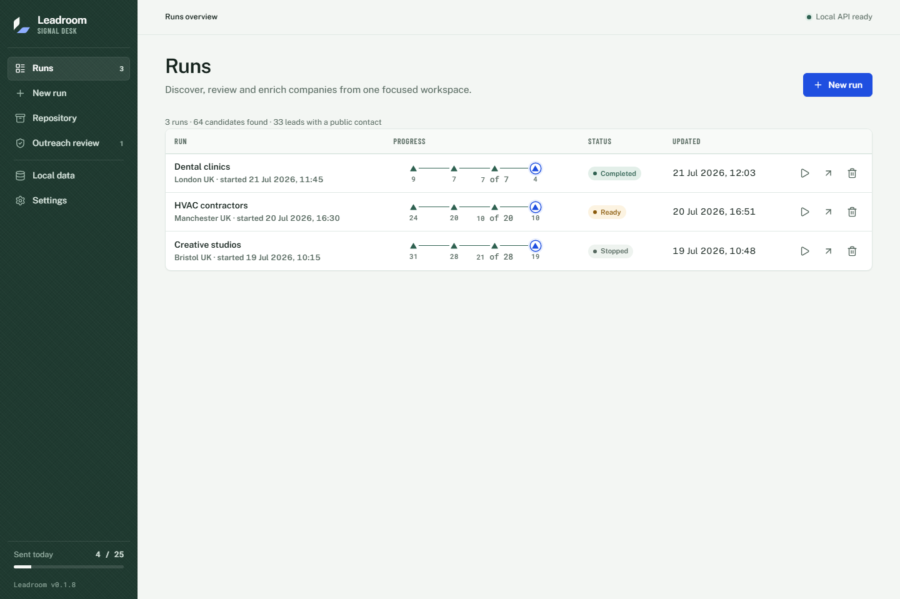
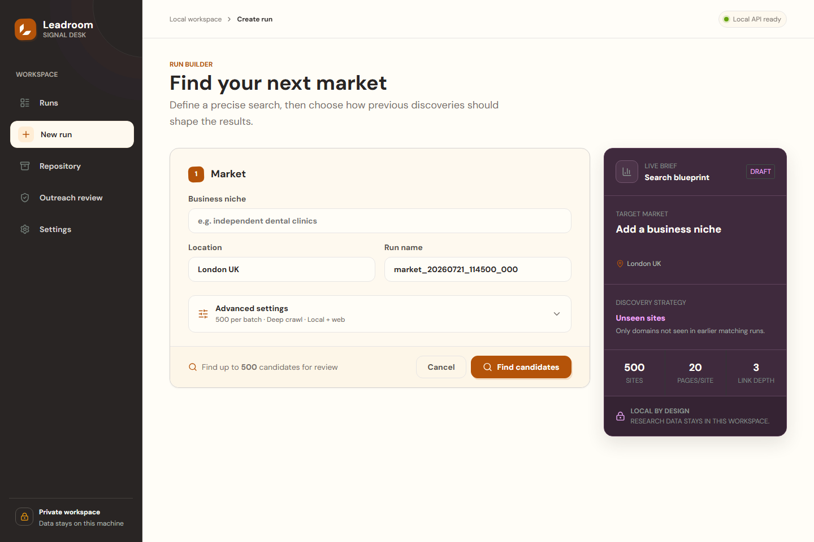
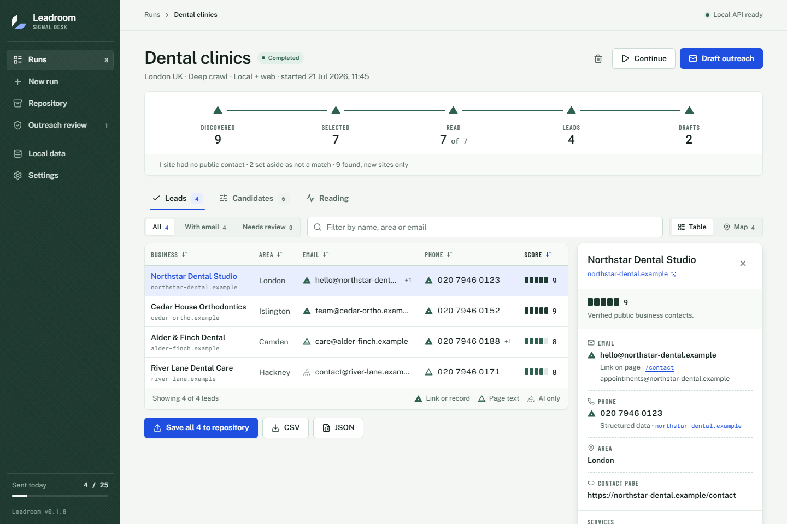
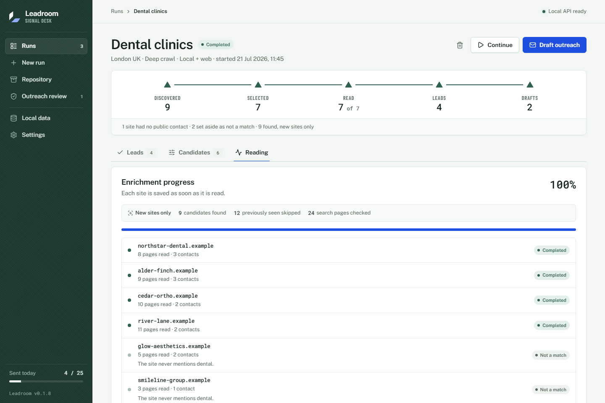
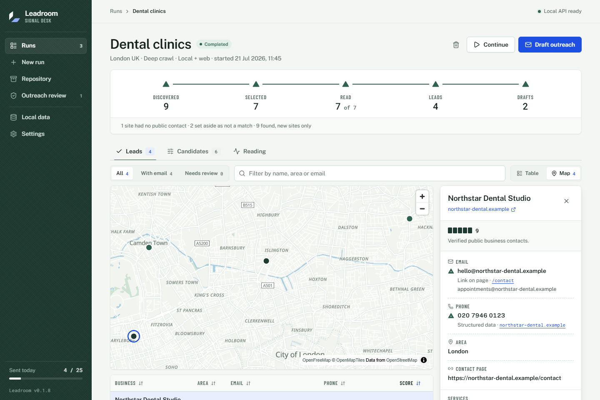
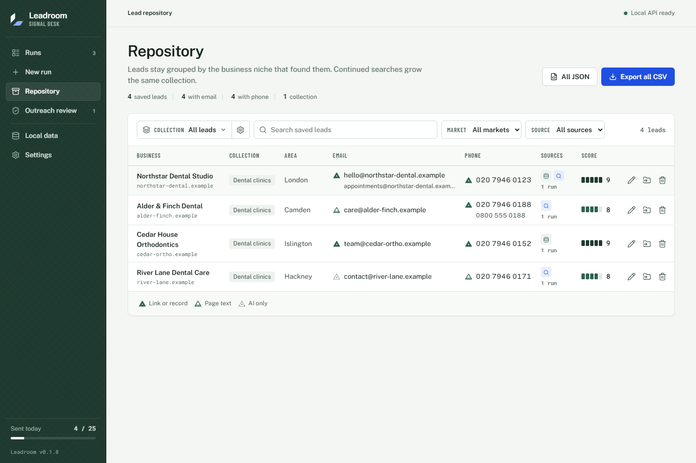
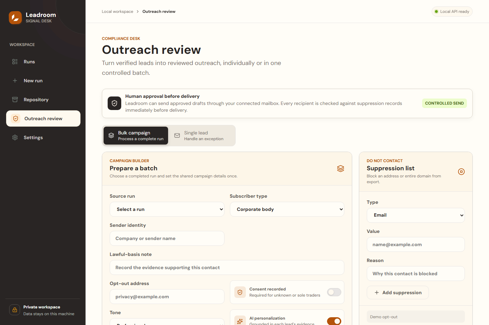
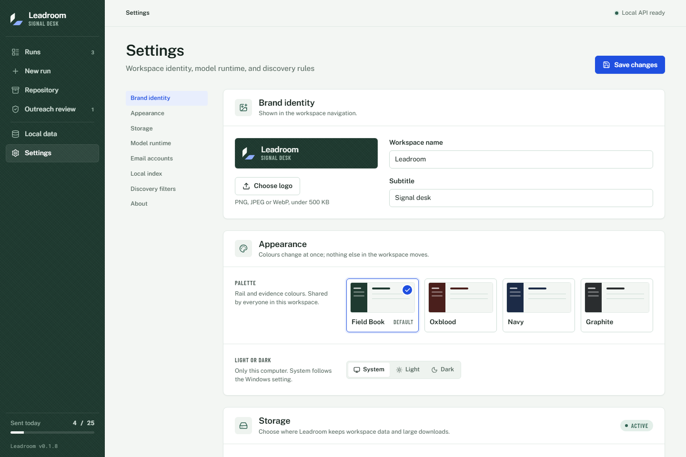

<p align="center">
  
</p>

<h1 align="center">Leadroom</h1>

<p align="center">
  <b>Find local businesses, collect their public contact details, and reach out carefully.<br>
  All from one private workspace on your Windows PC.</b>
</p>

<p align="center">
  <a href="https://github.com/thesaikodelik/Leadroom/releases/latest/download/Leadroom-Setup.exe"></a>
</p>

<p align="center">
  
  
  
  
  
  
</p>

<p align="center">
  <b>English</b> · <a href="README.fa.md">فارسی</a>
</p>

<p align="center">
  
</p>

**Leadroom** turns a business niche and a location, say *independent dental clinics in London*,
into a reviewed list of real businesses with their public emails and phone numbers. It searches
the web, reads each business's own website, lets a local AI model fill in the gaps, and keeps
every lead in one deduplicated repository that you can export or use for carefully controlled
outreach.

It runs on your computer. Your workspace, your leads and your keys stay on your PC, and the
default AI model runs locally through [Ollama](https://ollama.com/). Searching and crawling
websites still goes over the internet, of course.

<p align="center">
  <a href="#how-it-works">How it works</a> ·
  <a href="#repository">Repository</a> ·
  <a href="#outreach">Outreach</a> ·
  <a href="#settings">Settings</a> ·
  <a href="#install">Install</a> ·
  <a href="#privacy">Privacy</a> ·
  <a href="#developers">For developers</a>
</p>

---

<a id="how-it-works"></a>

## 🧭 How it works

### 1. Describe the market



Type a **business niche** and a **location**, and pick how wide to search.

- **Sources:** the web, a private local map index, or both at once.
- **A wide search:** Leadroom searches the market in the other words a business might use
  (*Persian* for *Iranian*), district by district across the city, and reads directories and
  "best of" lists for the businesses they name.
- **Unseen sites only:** a new run in the same market skips every domain you have already found.
- **Crawl depth:** *Quick* (up to 6 pages a site), *Deep* (up to 20) or *Exhaustive* (up to 40).
  Leadroom stops reading a site once it has found its contacts.
- A **live brief** on the right sums up what the run will do before you start.

<br clear="right">

### 2. Keep the businesses you actually want



Leadroom shows every **candidate** it found, with where it came from. Remove directories,
aggregators and anything outside your target market, then start enrichment for the rest.

- Follow each site's **progress**, errors and evidence while it runs.
- **Stop** and **continue** whenever you like; progress is saved after every site.
- Need more? **Continue** the same run: each search covers the next districts and the
  businesses the last lists named.

<br clear="right">

### 3. Let it read the websites for you



For each business, Leadroom stays on its own domain and reads the pages that matter first:
contact, about, services and locations, plus the sitemap.

It also checks that the business belongs to your market. A site that never mentions what
narrows it (the *Iranian* in *Iranian supermarket*) is set aside as **Not a match**, with the
reason, and stays out of your leads. A site that names the market in other words is kept
and marked for a quick check.

<br clear="right">

| Step | What happens |
| --- | --- |
| 🔎 **Extract** | Emails, phone numbers and business details are read straight from the page and its structured data. |
| 🧠 **Enrich** | A local AI model (through [ScrapeGraphAI](https://github.com/ScrapeGraphAI/Scrapegraph-ai)) fills in what the page doesn't state plainly. |
| 🛡 **Retry gently** | Pages that refuse a simple request are retried through Scrapling, then a real browser. Logins, paywalls and CAPTCHAs are never bypassed. |
| ✅ **Clean up** | Up to three emails and phone numbers per business, normalised and deduplicated. |

### 4. Check the evidence, and see where they are



Every email and phone carries a small triangle that says how it was found:

- **Solid**: the business published it as a link, in structured data or in its map record.
- **Lower third filled**: it appears in the text of the business's own pages.
- **Dotted outline**: an AI model read it and it wasn't matched on the page, so check it first.

Select a lead to see each detail's source page. Switch a run to **Map** to see its leads on a
map; leads without a map position stay in the list.

<br clear="right">

<a id="repository"></a>

## 🗂 One repository for every lead

<p align="center">
  
</p>

Save the good leads from any run into the **Repository**. Businesses are matched by their domain,
so running the same market again **adds to** a collection instead of duplicating it.

- **Collections** grouped by the niche that found them, with search and filters.
- **Evidence** for every value: which run and which page it came from.
- Edit, move or remove a lead right from its row.
- **Export** everything, or one collection, as CSV or JSON.

<a id="outreach"></a>

## ✉️ Outreach, with a human in charge



Turn a finished run into a reviewed email campaign. AI drafts each message from that business's
own evidence; **you approve every message** before Leadroom sends it through your mailbox.

- Only public business inboxes, with a minimum lead score.
- Lawful-basis and consent fields, plus a **do-not-contact list** checked again right before sending.
- **At most 25 emails in any 24 hours**, one campaign at a time, and a stop button.
- Works with any SMTP mailbox (STARTTLS or SSL/TLS).

> These checks reduce mistakes; they are not legal advice. Read [COMPLIANCE.md](COMPLIANCE.md)
> before contacting anyone. You are responsible for consent and for the law where you work.

<br clear="right">

<a id="settings"></a>

## 🎨 Make it yours



- **Your brand:** workspace name, subtitle and logo in the sidebar.
- **Ten themes**, all light on resources.
- **Model runtime:** list, download, switch and benchmark Ollama models, or plug in any
  OpenAI-compatible endpoint instead.
- **Storage:** keep the workspace and the large downloads (models, browser files, map data)
  on any drive.
- **Discovery rules:** your own blocklist of sites to ignore.

<br clear="right">

<a id="install"></a>

## 📦 Install

1. Download **[Leadroom-Setup.exe](https://github.com/thesaikodelik/Leadroom/releases/latest/download/Leadroom-Setup.exe)** from the
   [latest release](https://github.com/thesaikodelik/Leadroom/releases/latest).
2. Run it and follow the steps. Keep the recommended components ticked on a new PC.
3. Open **Leadroom** from the Start menu when Setup finishes.

The installer is made for a **brand-new PC**. It installs for your account only, needs **no
administrator rights**, and offers to set up everything Leadroom depends on:

| Component | What Setup does |
| --- | --- |
| **Microsoft Edge WebView2** | Installs it if missing (needed for the app window). |
| **Ollama** | Installs it if missing, through Windows Package Manager or, without it, straight from ollama.com. |
| **`llama3.2:3b` model** | Downloads it (about 2 GB) into the folder you choose, with live progress. |
| **Full Local map index** | Optional, for powerful PCs: WSL2, PostgreSQL and OpenStreetMap data. |

Prefer no installer? The release also has **Leadroom-Portable.zip**, which needs WebView2 and
Ollama to be installed already. Every step of Setup can be cancelled and existing installs are reused. The installer has been tested on
fresh Windows machines, both with and without Windows Package Manager.

> New, unsigned programs may get *"Windows protected your PC"*: choose **More info → Run anyway**.
> Leadroom is open source; read every line, or build it yourself.

**Updates come to you.** Leadroom checks for a new version while it is open and offers it in the sidebar; one click downloads it, and **Restart now** installs it and opens the new version. Every update is checked against the project's signature before it runs. Running a newer Setup over an older Leadroom also works, and keeps your workspace, models and map data.

Uninstall from **Settings → Apps**. Setup asks whether to keep your workspace and downloaded models.

**Requirements:** Windows 10 or 11 (64-bit), about 10 GB free for Ollama and the default model, and
an internet connection. Leadroom is a **pre-release** and is currently tuned for **UK** businesses (phone formats
and the map index).

**No graphics card?** Leadroom still works. The AI step, which reads each site's business type and services,
runs on the processor and can take about a minute per site. You can turn it off with **Read websites with AI**
in a run's options, or skip Ollama in Setup. Without it, Leadroom still collects emails, phone numbers and
contact pages from each site, and the offline map search needs no AI at all.

<a id="privacy"></a>

## 🔒 Private by design

- The app talks to its own engine only on `127.0.0.1`, with a fresh key every launch.
- Model keys, SMTP passwords and account secrets are encrypted with your Windows account (DPAPI).
- No accounts and no tracking. The default AI model runs on your PC, and Leadroom switches off the
  usage reporting built into ScrapeGraphAI, so page content is never uploaded for analytics.
- To look for updates, Leadroom reads this repository's public release list on GitHub about once an hour. The optional map index downloads OpenStreetMap changes from Geofabrik. Neither request carries your data.
- A run's **Map** view loads map tiles for the area on screen from [OpenFreeMap](https://openfreemap.org/), with no key or account. Only the tiles are requested; your leads are drawn on your PC and never sent. The table view needs no connection.
- The screenshots in this README use made-up `.example` businesses, not real data.

Found a security problem? Please report it privately, as described in [SECURITY.md](SECURITY.md).

---

<a id="developers"></a>

## 🛠 For developers

<details>
<summary><b>Run from source</b></summary>

You need Windows 10/11, Python 3.12 or 3.13, Node.js 22+ and [Ollama](https://ollama.com/).

```powershell
git clone https://github.com/thesaikodelik/Leadroom.git
cd Leadroom

python -m venv .venv
.\.venv\Scripts\Activate.ps1
python -m pip install --upgrade pip
python -m pip install -r requirements-dev.txt
npm ci --prefix frontend

ollama pull llama3.2:3b
python -m app.preflight
```

Defaults work without a `.env` file; copy `.env.example` to `.env` to change them. Never commit
`.env`, databases, exports, logs or model files.

```powershell
# Desktop window
.\.venv\Scripts\python.exe run_desktop.py

# Or browser mode, in two terminals (then open http://127.0.0.1:5173)
.\.venv\Scripts\python.exe run_api.py
npm run dev --prefix frontend

# Or the command line
.\.venv\Scripts\python.exe run_cli.py --niche "independent dental clinics" --location "London UK" --max-sites 10
```

</details>

<a id="build"></a>

<details>
<summary><b>Build the installer</b></summary>

Install [Inno Setup 6](https://jrsoftware.org/isinfo.php) (`winget install JRSoftware.InnoSetup`), then:

```powershell
.\scripts\build-release.ps1
```

This writes `Leadroom-Setup.exe`, `Leadroom-Portable.zip` and `checksums.txt` to `dist\`.
Installer options, silent parameters and smoke tests are in [docs/PACKAGING.md](docs/PACKAGING.md).
The **Installer clean-machine test** workflow builds the installer and installs it on fresh
Windows runners.

</details>

<details>
<summary><b>Tests</b></summary>

```powershell
.\scripts\check.ps1
```

Or one layer at a time:

```powershell
.\.venv\Scripts\python.exe -m pytest
.\.venv\Scripts\python.exe -m ruff check app tests run_cli.py run_api.py
npm run lint --prefix frontend
npm test --prefix frontend
npm run test:e2e --prefix frontend   # needs the Vite dev server running
```

The README screenshots come from fictional data; regenerate them with
`npx playwright test e2e/readme-screenshots.spec.ts --project=desktop --workers=1` inside
`frontend` while Vite runs. Test layers and budgets: [TEST_STRATEGY.md](TEST_STRATEGY.md).

</details>

<details>
<summary><b>Optional private map index (OpenStreetMap)</b></summary>

For unlimited local discovery without a search API, Leadroom can build a PostgreSQL/PostGIS index
of Great Britain from OpenStreetMap inside WSL2. It needs about 2 GB to download and 25 GB after
import. Web-only discovery does not need it.

```powershell
.\scripts\setup-local-data.ps1
.\scripts\import-osm.ps1
```

Review the scripts and storage needs first. Map data © OpenStreetMap contributors, under the ODbL.

</details>

<details>
<summary><b>Architecture</b></summary>

```text
React + TypeScript
        |
FastAPI on 127.0.0.1 ---> SQLite: runs, repository, compliance
        |
        +-- DDGS / optional Brave web discovery
        +-- optional PostgreSQL + PostGIS + OpenStreetMap discovery
        +-- bounded crawl: httpx -> Scrapling -> Playwright
        +-- deterministic contact extraction
        +-- ScrapeGraphAI + Ollama or an OpenAI-compatible model
        +-- SMTP, only after review and approval
```

| Module | Role |
| --- | --- |
| `app/api.py` | API and background jobs |
| `app/search.py`, `app/search_providers.py` | Discovery and continuation |
| `app/local_data.py`, `infra/osm/` | Private OpenStreetMap index |
| `app/enrichment.py`, `app/scraper.py` | Crawling, fetching, contacts and AI extraction |
| `app/database.py` | Runs, repository merging, settings and migrations |
| `app/compliance.py`, `app/outreach_ai.py`, `app/email_delivery.py` | Reviewed outreach |
| `app/storage.py`, `app/secrets.py` | Data folders and Windows DPAPI |
| `run_desktop.py` | Desktop window lifecycle |
| `frontend/` | React 19, TypeScript, TanStack Query/Table, Motion and Vite |

</details>

## 🌱 Origin and credits

Leadroom began as a prototype around `SmartScraperGraph` from the open-source
[ScrapeGraphAI](https://github.com/ScrapeGraphAI/Scrapegraph-ai) project, which still powers its
AI extraction. Everything else (discovery, the map index, the workspace, the repository, the
desktop app and outreach) was built for Leadroom. It is an independent project, not affiliated
with or endorsed by ScrapeGraphAI.

> **AI authorship:** all application code in this repository was written by AI under human
> direction, product decisions, testing and review.

## 🤝 Contributing and license

Issues and pull requests are welcome; read [CONTRIBUTING.md](CONTRIBUTING.md) and
[CODE_OF_CONDUCT.md](CODE_OF_CONDUCT.md) first, and keep real data, databases and credentials out
of commits.

Leadroom's source code is released under the [MIT License](LICENSE). The Windows downloads bundle
[html2text](https://github.com/Alir3z4/html2text), so they are distributed under the
[GPL-3.0-or-later](licenses/GPL-3.0.txt) as a whole, with the licence of every bundled package in
`THIRD_PARTY_LICENSES.txt`. ScrapeGraphAI and OpenStreetMap data keep their own licences; see [THIRD_PARTY_NOTICES.md](THIRD_PARTY_NOTICES.md), [NOTICE.md](NOTICE.md) and
the [dependency licence review](docs/DEPENDENCY_LICENSES.md).
